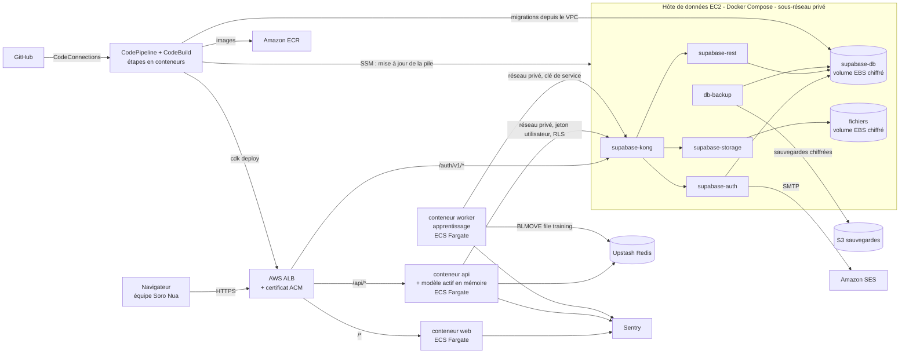
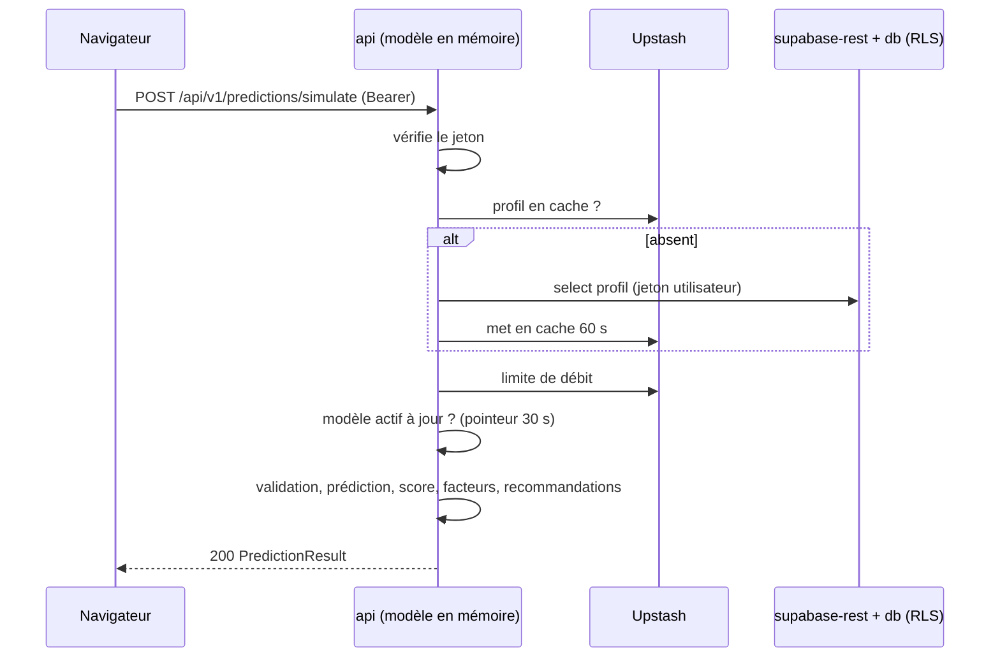
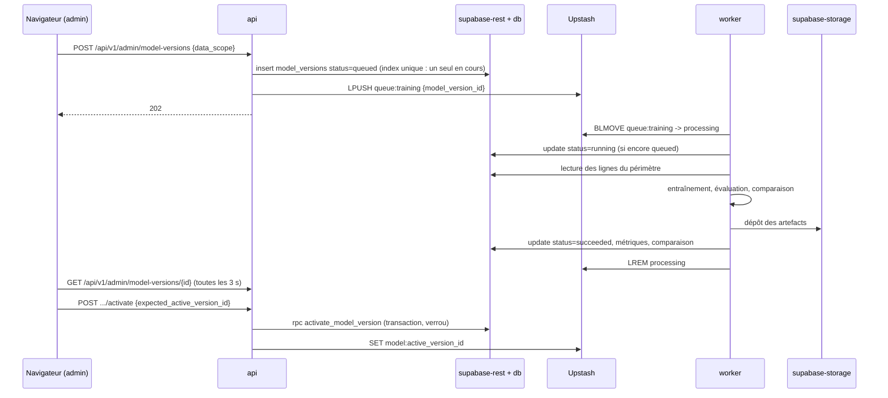

# ARCHITECTURE.md : Soro Nua Campaign Predictor

Document de référence n°3 sur 13.

---

## 1. Vue d'ensemble

### 1.1 Principe : tout est conteneurisé

**Chaque composant de la solution tourne dans un conteneur Docker, en local comme sur AWS** :
- l'interface ;
- l'API ;
- le modèle (apprentissage et prédiction) ;
- la base de données, l'authentification et le stockage de fichiers.

Aucun composant n'est installé directement sur une machine. Les mêmes images et le même fichier de composition Supabase servent en local, en staging et en production.

Seuls restent hors conteneurs les **services tiers en ligne** de la stack imposée, qui n'existent pas sous forme installable ou dont c'est la raison d'être d'être externes :
- Upstash (cache et file) : service uniquement en ligne ; en local, un conteneur Redis le remplace, avec le même protocole.
- Sentry, Amazon SES, GitHub, AWS CodePipeline et CodeBuild.

Les pipelines CodeBuild exécutent eux-mêmes toutes leurs étapes dans des conteneurs.

### 1.2 Inventaire des conteneurs

| Conteneur | Image | Rôle | Local | Staging / production |
|---|---|---|---|---|
| `web` | `soronua-predict-web` (Next.js) | Interface | oui | ECS Fargate |
| `api` | `soronua-predict-api` | API métier **et service du modèle** (prédictions à partir de la version active chargée en mémoire) | oui | ECS Fargate |
| `worker` | `soronua-predict-api` (même image, commande `python -m app.worker`) | **Apprentissage du modèle** | oui | ECS Fargate |
| `supabase-db` | `supabase/postgres` | Base de données Postgres | oui | hôte de données (EC2) |
| `supabase-auth` | `supabase/gotrue` | Comptes, mots de passe, invitations, jetons | oui | hôte de données |
| `supabase-rest` | `postgrest/postgrest` | Accès aux tables avec RLS | oui | hôte de données |
| `supabase-storage` | `supabase/storage-api` | Fichiers CSV importés et artefacts du modèle (sur volume disque) | oui | hôte de données |
| `supabase-kong` | `kong` | Passerelle d'entrée de la pile Supabase | oui | hôte de données |
| `supabase-meta` + `supabase-studio` | `supabase/postgres-meta`, `supabase/studio` | Console d'administration de la base | oui | non déployés |
| `db-backup` | `soronua-predict-db-backup` (construite dans le dépôt) | Sauvegarde nocturne de la base et des fichiers vers S3 | non | hôte de données |
| `redis` | `redis:7.4-alpine` | Remplaçant local d'Upstash | oui | non (Upstash) |
| `mailpit` | `axllent/mailpit` | Boîte mail locale (invitations, réinitialisations) | oui | non (Amazon SES) |

Phase 0 (voir `decisions.md` D-006 et D-008) : seuls `web`, `api` et `redis` tournent au démarrage de `make up` ; `worker`, `mailpit` et la pile Supabase arrivent avec les phases 1 et 6, `db-backup` avec la phase 17. Toutes les images se construisent avec le dépôt entier comme contexte (`context: .`, un seul `.dockerignore` à la racine), car l'image `api` devra embarquer `data/seed/`, hors de `apps/api`.

Les services Supabase non utilisés par le produit ne sont pas déployés :
- temps réel (`realtime`) ;
- fonctions (`edge-runtime`) ;
- journaux analytiques (`analytics`, `vector`) ;
- regroupement de connexions (`supavisor`) ;
- transformation d'images (`imgproxy`).

### 1.3 Schéma

Un seul nom de domaine par environnement. Le répartiteur de charge (ALB) envoie :
- `/api/*` vers `api` ;
- `/auth/v1/*` vers la passerelle `supabase-kong` (connexion, rafraîchissement, invitations) ;
- tout le reste vers `web`.

Le navigateur n'appelle donc qu'une seule origine : aucune configuration CORS n'est nécessaire. Les accès aux tables (`/rest/v1`) et aux fichiers (`/storage/v1`) **ne sont pas exposés sur Internet**. Seuls `api` et `worker` y accèdent, par le réseau privé.

## 2. Composants majeurs

### 2.1 web (Next.js)
- Rendu des pages, formulaires, graphiques.
- Session Supabase stockée en cookies via `@supabase/ssr`, en parlant à `/auth/v1` sur la même origine. Le middleware Next.js rafraîchit la session et protège les routes.
- Tous les échanges de données passent par l'API (`/api/v1/...`) avec l'en-tête `Authorization: Bearer <access_token>`. Le navigateur n'interroge jamais les tables.
- Ne détient aucun secret serveur. Seules l'URL publique et la clé publique (anon) Supabase sont exposées.
- En local, le navigateur ne parle qu'à l'origine du web : les appels `/api/*` sont réécrits par Next.js vers l'API (variable `API_PROXY_TARGET`, lue par `next.config.ts`), comme le fait l'ALB sur AWS. Il n'y a pas de réécriture dans l'image de production (voir `decisions.md` D-026).

### 2.2 api (FastAPI) : service métier et service du modèle
- Vérifie le jeton (signature HS256 avec le secret de la pile Supabase, expiration, audience, émetteur), charge le profil (rôle, statut actif) avec un cache de 60 secondes dans Upstash.
- Accède à Postgres via `supabase-rest` **avec le jeton de l'utilisateur** : les règles d'isolation (RLS) s'appliquent à chaque requête. La clé de service n'est utilisée que dans les cas listés en section 2.5.
- **Sert le modèle** : garde en mémoire la version active (trois modèles XGBoost + paquet de référence), lue depuis `supabase-storage`. Vérifie toutes les 30 secondes, via une clé Upstash, si la version active a changé, et la recharge le cas échéant.
- Expose `/api/health` (vivant) et `/api/ready` (base, cache et modèle accessibles).

### 2.3 worker (Python) : apprentissage du modèle
- Boucle d'attente sur la file Upstash `queue:training` (commande bloquante `BLMOVE`, délai 20 secondes).
- Pour chaque demande :
  - passe la version en "running" ;
  - lit les données du périmètre ;
  - entraîne, évalue, compare à la version active ;
  - dépose les artefacts dans `supabase-storage` ;
  - passe la version en "succeeded" ou "failed".
- Écrit un fichier de battement de cœur toutes les 30 secondes ; le contrôle de santé du conteneur le redémarre si le battement a plus de 120 secondes.
- Une seule instance par environnement (un seul apprentissage à la fois, garanti aussi par la base).
- `api` et `worker` partagent la même image : le code qui entraîne le modèle est exactement celui qui le sert.

### 2.4 Supabase auto-hébergé
Pile officielle de Supabase pour l'auto-hébergement (fichier `docker-compose` publié par Supabase), réduite aux services utiles, versions figées, stockée dans `deploy/supabase/`.
- **Auth (`supabase-auth`)** :
  - comptes, mots de passe, invitations, réinitialisation ;
  - jetons d'accès (1 heure) et de rafraîchissement (rotation activée) ;
  - inscription publique désactivée (`GOTRUE_DISABLE_SIGNUP=true`) ;
  - envoi des e-mails par SMTP (Mailpit en local, Amazon SES ailleurs) ;
  - gabarits d'e-mails servis par `web` (`/auth-templates/*.html`).
- **Postgres (`supabase-db`)** : tables du produit, règles RLS, fonctions de contrôle (voir `DATA_MODEL.md`). Données sur un volume dédié.
- **REST (`supabase-rest`)** : accès aux tables pour `api` et `worker`, RLS appliquée selon le jeton.
- **Storage (`supabase-storage`)** : deux espaces privés, `dataset-uploads` et `model-artifacts`, fichiers écrits sur un volume disque (pas de dépendance à un stockage externe).
- **Kong (`supabase-kong`)** : passerelle unique ; vérifie la présence de la clé (anon ou service) ; route `/kong-health` (plugin `request-termination`) pour le contrôle de santé de l'ALB.
- Clés : un secret JWT propre à chaque environnement ; les clés `anon` et `service_role` sont des jetons signés avec ce secret, générés par `deploy/supabase/generate_keys.py`.

### 2.5 Utilisation de la clé de service Supabase (liste fermée)
1. `worker` : lecture des données d'apprentissage, écriture des résultats et artefacts.
2. `api`, module `model_registry` : lecture des artefacts dans `model-artifacts`.
3. `api`, module `user_admin_service` : invitation et bannissement d'utilisateurs (API d'administration de `supabase-auth`), après vérification que l'appelant est administrateur.
4. Commandes d'exploitation (`app.cli.*`) : amorçage, chargement du jeu de départ, utilisateurs de test, réactivation d'une version.

Toute autre utilisation est interdite (voir `CLAUDE.md`).

### 2.6 Upstash Redis
| Usage | Clé | Durée de vie |
|---|---|---|
| File d'apprentissage | `queue:training` et `queue:training:processing` (listes) | permanente |
| Pointeur de version active | `model:active_version_id` | permanente |
| Cache de profil | `auth:profile:{user_id}` | 60 s |
| Limitation de débit | `ratelimit:{scope}:{user_id}:{window}` | durée de la fenêtre |

Si Upstash est indisponible :
- le cache de profil et le pointeur sont relus en base (mode dégradé) ;
- la limitation de débit laisse passer et remonte une alerte Sentry ;
- le lancement d'apprentissage renvoie 503.

### 2.7 Hôte de données (staging et production)
- Une instance EC2 par environnement, dans un sous-réseau privé, sans adresse publique ni accès SSH. L'administration se fait uniquement par AWS Systems Manager (SSM).
- Tailles :
  - staging : `t3.medium` (2 vCPU, 4 Go) ;
  - production : `t3.large` (2 vCPU, 8 Go).
- Système Amazon Linux 2023, Docker et Docker Compose installés au démarrage (script CDK), agent SSM.
- Volume EBS `gp3` chiffré de 50 Go monté sur `/srv/supabase` : données Postgres et fichiers du stockage.
- La pile `deploy/supabase/docker-compose.yml` est lancée par un service `systemd` (redémarrage automatique au démarrage de la machine).
- Mises à jour par le pipeline (`CI_CD.md`) via SSM :
  1. téléchargement du paquet de déploiement depuis S3 ;
  2. génération du fichier `.env` à partir de Secrets Manager ;
  3. `docker compose pull` puis `docker compose up -d` ;
  4. attente des contrôles de santé.
- Sauvegardes :
  - `db-backup` : chaque nuit, `pg_dump` au format personnalisé et copie des fichiers du stockage vers le compartiment S3 `soronua-predict-<env>-backups` (chiffré, versionné, conservation 30 jours) ;
  - en plus, AWS Backup prend un instantané quotidien du volume EBS (conservation 14 jours).
- Montée en charge : verticale (changer le type d'instance). Point unique de défaillance assumé pour un outil interne ; la reconstruction depuis sauvegarde est décrite et testée (`CI_CD.md` 6.2, `ROADMAP.md` phase 20).

## 3. Échanges principaux

### 3.1 Prédiction (simulation)

L'enregistrement (`POST /api/v1/predictions`) suit le même chemin, puis insère la ligne dans `predictions` avec le jeton de l'utilisateur.

### 3.2 Apprentissage

## 4. Choix de stack

| Élément | Choix | Justification |
|---|---|---|
| Conteneurisation | Docker partout (Docker Compose en local et sur l'hôte de données, ECS Fargate pour l'application) | Exigence du projet : chaque composant, base de données comprise, tourne dans un conteneur, avec les mêmes images d'un environnement à l'autre. |
| Base de données, authentification, stockage | Supabase **auto-hébergé** (pile Docker officielle) | Imposé (Supabase) et conteneurisable ; les règles RLS de Postgres garantissent l'isolation des données au plus près des données. |
| Exécution de la pile Supabase sur AWS | EC2 + Docker Compose + volume EBS | Une base de données a besoin d'un disque persistant, ce que Fargate n'offre pas durablement ; Docker Compose est le mode d'installation documenté par Supabase. |
| Stockage de fichiers | Supabase Storage sur volume disque | Même système de droits que la base, et tout reste dans les conteneurs. |
| Sauvegardes | Conteneur `db-backup` vers S3 + instantanés AWS Backup | Deux mécanismes indépendants, standard sur AWS, remplaçant les sauvegardes d'un service géré. |
| Hébergement de l'application | AWS ECS Fargate, région `eu-west-3` (Paris) | Imposé (AWS) ; Fargate exécute les conteneurs sans serveur à administrer, et Paris est la région AWS de référence la plus proche du Cameroun. |
| Répartition de charge | AWS Application Load Balancer + certificat ACM | Routage par chemin et HTTPS gérés par AWS. |
| Administration des machines | AWS Systems Manager | Aucun port SSH ouvert, actions tracées. |
| Infrastructure décrite en code | AWS CDK (Python) | Outil officiel d'AWS, dans le même langage que l'API. |
| CI/CD | AWS CodePipeline (V2) + CodeBuild + CodeConnections (GitHub) | Imposé (CI/CD sur AWS) ; services natifs, intégrés aux autorisations AWS. |
| Registre d'images | Amazon ECR | Registre natif AWS, lu directement par ECS. |
| Secrets | AWS Secrets Manager | Les secrets sont injectés dans les conteneurs au démarrage sans jamais apparaître dans le code. |
| Journaux | Amazon CloudWatch Logs (pilote `awslogs` pour tous les conteneurs, y compris ceux de l'hôte de données) | Tous les journaux au même endroit. |
| Cache et file d'attente | Upstash Redis (conteneur `redis` en local) | Imposé ; service uniquement en ligne, compatible avec le protocole Redis standard utilisé en local. |
| Surveillance des erreurs | Sentry | Imposé ; trois projets (web, api, worker) partageant le même identifiant de version. |
| Tests d'interface | Playwright (image Docker officielle) | Imposé. |
| Versionnement | GitHub | Imposé ; protections de branches sur `dev`, `staging` et `main`. |
| IA générative | Gemini : **non utilisé** en première version | Le produit n'a pas besoin de modèle de langage ; les prédictions viennent de XGBoost (voir PRD L-05). |
| Langage API et apprentissage | Python 3.12 | Langage de référence de XGBoost et de l'écosystème de données. |
| Framework API | FastAPI | Validation des entrées par schémas et documentation OpenAPI générée automatiquement. |
| Apprentissage | XGBoost | Imposé par le brief ; ses contributions par variable (`pred_contribs`) donnent les facteurs sans bibliothèque supplémentaire. |
| Interface | Next.js 15 (App Router) + TypeScript | Framework React le plus répandu, compatible avec `@supabase/ssr` et `@sentry/nextjs`. |
| Composants visuels | Tailwind CSS + shadcn/ui | Composants accessibles copiés dans le dépôt, sans dépendance à une bibliothèque fermée. |
| Graphiques | Recharts | Bibliothèque de graphiques React la plus documentée. |
| E-mails d'authentification | Amazon SES (SMTP) branché sur `supabase-auth` ; Mailpit en local | Service d'envoi le plus standard sur AWS. |

## 5. Cible de déploiement

| Environnement | Branche | Application | Pile Supabase | Cache | URL |
|---|---|---|---|---|---|
| local | toute branche de travail | Docker Compose | Docker Compose (même fichier `deploy/supabase/docker-compose.yml`) | conteneur `redis` | `http://localhost:3000` |
| dev | `dev` | aucun déploiement ; contrôles automatiques (dans des conteneurs) | n/a | n/a | n/a |
| staging | `staging` | ECS Fargate, pile `SoroNuaPredict-staging` | hôte de données `soronua-predict-staging-data` | Upstash `soronua-predict-staging` | `https://staging-predict.<DOMAIN_NAME>` |
| production | `main` | ECS Fargate, pile `SoroNuaPredict-prod` | hôte de données `soronua-predict-prod-data` | Upstash `soronua-predict-prod` | `https://predict.<DOMAIN_NAME>` |

Ressources AWS par environnement (staging et production) :
- VPC sur 2 zones de disponibilité, sous-réseaux publics (ALB) et privés (tâches ECS, hôte de données), une passerelle NAT.
- Cluster ECS avec trois services :
  - `api` : 0,5 vCPU, 1 Go, 1 à 4 tâches, mise à l'échelle sur CPU à 60 % ;
  - `web` : 0,25 vCPU, 0,5 Go, 1 à 3 tâches ;
  - `worker` : 1 vCPU, 2 Go, 1 tâche.
- Disjoncteur de déploiement ECS activé avec retour arrière automatique.
- Hôte de données (section 2.7), enregistrement DNS privé `data.<env>.internal` (zone Route 53 privée).
- ALB en HTTPS (redirection 80 vers 443), règles `/api/*` et `/auth/v1/*`.
- Groupes de sécurité :

  | Élément | Entrées autorisées |
  |---|---|
  | ALB | 443 depuis Internet |
  | `web` et `api` | depuis l'ALB uniquement |
  | `worker` | aucune entrée |
  | Hôte de données, port 8000 (Kong) | depuis l'ALB, `api`, `worker` et le groupe de sécurité CodeBuild |
  | Hôte de données, port 5432 (Postgres) | depuis le groupe de sécurité CodeBuild uniquement (migrations) |
  | Hôte de données, tout autre port | aucune entrée |
- Secrets Manager :
  - `soronua-predict/<env>/app` : application ;
  - `soronua-predict/<env>/web-build` : construction de l'image web ;
  - `soronua-predict/<env>/data` : pile Supabase.
- Compartiments S3 : `soronua-predict-<env>-backups` (sauvegardes) et `soronua-predict-<env>-deploy` (paquets de déploiement de la pile Supabase).
- Alarmes CloudWatch vers un sujet SNS envoyant un e-mail à `ALARM_NOTIFICATION_EMAIL` :
  - taux d'erreurs 5xx ;
  - cibles non saines ;
  - worker arrêté ;
  - hôte de données : processeur, mémoire, disque plein à 80 % ;
  - sauvegarde nocturne manquante.

## 6. Intégrations tierces

| Service | Usage | Point d'intégration |
|---|---|---|
| Supabase (auto-hébergé, conteneurs) | Auth, Postgres, Storage | `supabase` (Python), `@supabase/supabase-js` et `@supabase/ssr` (web), Supabase CLI pour les migrations (`--db-url`) |
| Upstash Redis | File, cache, limites | `redis` (Python) en TLS (`rediss://`) |
| Sentry | Erreurs et traces | `sentry-sdk` (api, worker), `@sentry/nextjs` (web), `sentry-cli` dans CodeBuild |
| Amazon SES | E-mails d'invitation et de réinitialisation | Variables SMTP de `supabase-auth` |
| GitHub | Code, pull requests, protections | AWS CodeConnections + webhooks CodeBuild |
| Gemini | Non utilisé | n/a |

## 7. Décisions d'architecture (journal)

| ID | Décision | Raison |
|---|---|---|
| AD-01 | Le navigateur n'accède pas directement aux tables | Une seule porte d'entrée validée (l'API) ; la RLS reste une seconde barrière. |
| AD-02 | L'API interroge Postgres avec le jeton de l'utilisateur | Isolation garantie par la base même en cas d'erreur dans le code. |
| AD-03 | File d'attente sur Redis (listes + `BLMOVE`) | Le worker reste dans un sous-réseau privé, sans point d'entrée public. |
| AD-04 | Une seule image pour api et worker | Le modèle servi est produit par exactement le même code que celui qui l'entraîne. |
| AD-05 | Lignes de test désignées une fois pour toutes à l'insertion | Les comparaisons entre versions se font sur des lignes qu'aucune version n'a vues. |
| AD-06 | Environnement `dev` non déployé | Évite un troisième environnement payant ; `dev` est vérifié par les contrôles automatiques. |
| AD-07 | Même origine pour web, api et authentification | Pas de CORS, cookies simples, surface d'attaque réduite. |
| AD-08 | Supabase auto-hébergé en conteneurs sur un hôte EC2 dédié | Exigence "tout conteneurisé" ; même pile en local et sur AWS. En contrepartie, les sauvegardes, mises à jour et la surveillance de la base sont à notre charge (sections 2.7 et `CI_CD.md`). |
| AD-09 | Seul `/auth/v1` de la pile Supabase est exposé sur Internet | Les tables et fichiers ne sont joignables que par le réseau privé. |
| AD-10 | Upstash, Sentry et SES restent des services en ligne | Ils font partie de la stack imposée et n'ont pas d'équivalent installable identique ; les remplacer par des conteneurs serait une substitution. |
