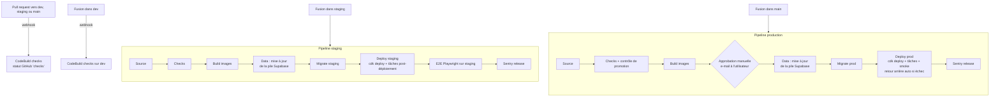

# CI_CD.md : Intégration et déploiement continus sur AWS

Document de référence n°11 sur 13.
Outils : AWS CodePipeline (type V2), AWS CodeBuild, AWS CodeConnections (GitHub), Amazon ECR, AWS CDK, AWS Secrets Manager, Amazon SNS. Aucun service CI hors AWS (pas de GitHub Actions).

---

## 1. Vue d'ensemble



## 2. Ressources CI/CD (pile `SoroNuaPredict-cicd`)

Déployée une fois par Claude Code (`cdk deploy SoroNuaPredict-cicd`), puis mise à jour de la même façon quand `pipeline_stack.py` change.

| Ressource | Nom | Rôle |
|---|---|---|
| Connexion GitHub | `soronua-predict-github` | Source des pipelines et webhooks. |
| Projet CodeBuild | `soronua-predict-checks` | Contrôles des pull requests et des poussées sur `dev`. Mode privilégié (Docker). Rapporte le statut GitHub sous le nom `checks`. |
| Projet CodeBuild | `soronua-predict-build` | Construction et publication des images. |
| Projet CodeBuild | `soronua-predict-data-host` | Mise à jour de la pile Supabase de l'hôte de données par SSM. |
| Projet CodeBuild | `soronua-predict-migrate` | Migrations de la base, exécuté **dans le VPC** de l'environnement (seul accès autorisé au port 5432). |
| Projet CodeBuild | `soronua-predict-deploy` | `cdk deploy` et tâches post-déploiement. |
| Projet CodeBuild | `soronua-predict-e2e` | Playwright sur staging. |
| Projet CodeBuild | `soronua-predict-smoke` | Playwright `@smoke` sur production. |
| Projet CodeBuild | `soronua-predict-sentry` | Déclaration des versions Sentry. |
| Pipeline | `soronua-predict-staging` | Déclenché par une poussée sur `staging`. |
| Pipeline | `soronua-predict-prod` | Déclenché par une poussée sur `main`. |
| Sujet SNS | `soronua-predict-approvals` | E-mail d'approbation vers `APPROVAL_NOTIFICATION_EMAIL`. |
| Sujet SNS | `soronua-predict-alerts` | Échecs de pipeline et alarmes vers `ALARM_NOTIFICATION_EMAIL`. |
| Règles de notification | sur les deux pipelines | Échec d'exécution, approbation en attente. |

Environnement CodeBuild commun :
- image `aws/codebuild/standard:7.0` en mode privilégié, utilisée uniquement comme moteur Docker ;
- aucune commande n'est installée directement sur l'environnement CodeBuild : tout s'exécute dans des conteneurs, comme en local (`CONVENTIONS.md` section 2) ;
- les contrôles du code s'exécutent dans **les images du projet** : contrôles Python (formatage, lint, types, tests, `pip-audit`, cohérence du verrou `uv`) dans l'image de développement `api`, contrôles web (formatage, lint, types, Vitest, `npm audit`) dans l'image de développement `web`, Playwright dans le service `e2e` (image Playwright officielle de même version que `@playwright/test`). Ainsi les contrôles utilisent les mêmes versions de Python et de Node que la production, et aucun dossier `.venv` ou `node_modules` d'une autre architecture n'est créé dans le dossier monté ;
- le conteneur `soronua-predict-toolbox` (construit au début de chaque buildspec depuis `tools/Dockerfile`, versions figées, accéléré par le cache Docker de CodeBuild) porte les autres outils : `uv lock`, `gitleaks`, `pre-commit`, Supabase CLI, AWS CLI, CDK, `npm audit` des outils racine ;
- les buildspecs appellent les mêmes cibles `make` que le poste de développement ; aucune commande de contrôle n'est écrite deux fois.

Cache CodeBuild local (Docker et dossiers `node_modules`, `~/.cache/uv`) activé.

## 3. Déclencheurs

| Événement GitHub | Déclenche | Déploie |
|---|---|---|
| Pull request ouverte, mise à jour ou rouverte vers `dev`, `staging` ou `main` | `soronua-predict-checks` | non |
| Poussée sur `dev` (fusion d'une pull request) | `soronua-predict-checks` | non |
| Poussée sur `staging` | pipeline `soronua-predict-staging` | staging |
| Poussée sur `main` | pipeline `soronua-predict-prod` | production, après approbation |
| Poussée sur toute autre branche | rien | non |

## 4. Étapes détaillées

### 4.1 Checks (`buildspecs/checks.yml`)
Utilisé seul pour les pull requests et `dev`, et comme étape "Checks" des deux pipelines.

1. **Règle de promotion** (pull requests uniquement) : base `staging` exige une source `dev` ; base `main` exige une source `staging`. Sinon échec avec message explicite.
2. **Secrets** : `make secrets` (`gitleaks git` sur l'historique de la branche, version figée dans `tools/Dockerfile`).
3. **Installation** : `make setup`.
4. **Pile locale** : `make up` (Supabase auto-hébergé, Redis, Mailpit, api, worker, web, tous en conteneurs dans CodeBuild ; `make check` relance `up` en première étape, sans effet si la pile tourne déjà).
5. **Contrôles** : `make check`, qui enchaîne neuf étapes et s'arrête à la première qui échoue :
   1. `up` (toute la pile locale saine, Supabase et Mailpit compris, puis migrations appliquées ; la pile démarre vraiment depuis la phase 1) ;
   2. `format-check` (ruff, Prettier) ;
   3. `lint` (garde sur la version de Playwright et sur les tests ignorés, gardes sur la configuration Compose résolue : digests, secrets dans `web`, ports publiés ; ruff, ESLint, `docker compose config`, `uv lock --check`) ;
   4. `typecheck` (`mypy --strict` sur `apps/api/app`, `tsc`) ;
   5. `api-types-check` (`types.gen.ts` identique à ce que génère l'API en cours d'exécution) ;
   6. `test-unit` (pytest unitaire, Vitest avec seuils de couverture) ;
   7. `test-integration` (pytest d'intégration, puis seuil de couverture global de l'API) ;
   8. `test-db` (pgTAP réel depuis la phase 1 : `pg_prove` dans le service `pgtap`, voir `TESTING.md` section 2) ;
   9. `audit` (voir la règle ci-dessous).
   `make test-e2e` est lancé séparément (point 9 de la liste principale) : il n'est pas dans `make check`.
   **Images publiques** : depuis la phase 1, l'étape « Checks » tire les images figées de la pile Supabase, de Mailpit et de `pg_prove` depuis `public.ecr.aws` (miroir ECR public, D-046) : prévoir l'accès sortant et les limites de débit de l'ECR public dans CodeBuild (à vérifier en phase 18).
   **Règle des audits** : (a) Python : `pip-audit` sur l'export figé du verrou `uv` ; `pip-audit` ne classe pas la gravité, donc toute vulnérabilité connue bloque ; (b) web : `npm audit --omit=dev --audit-level=high` (dépendances d'exécution : `HIGH` bloque) **et** `npm audit --audit-level=critical` (toutes dépendances : `CRITICAL` bloque) ; (c) outils racine (Supabase CLI) : `npm audit --audit-level=high`. Le seuil `npm audit --audit-level=high` sur toutes les dépendances du web ne peut pas être tenu : la chaîne de développement de Tailwind 3 et d'`eslint-config-next` (`braces`, `micromatch`) n'a pas de correctif avant Tailwind 4 et `eslint-config-next` 16 ; elle ne finit pas dans l'image de production. Aucune option `--ignore-vuln` ni règle ignorée sans ligne dans `docs/decisions.md`.
6. **Couverture** : seuils de `TESTING.md` section 4 vérifiés ; rapports publiés dans CodeBuild Reports. En phase 0, les seuils sont portés par `make test-unit` et `make test-integration` (voir `TESTING.md` section 4) ; la vérification par périmètre de `tools/check_coverage.py` est ajoutée en phase 7.
7. **Infrastructure** : `cdk synth` des piles staging et production + tests `infra/tests`.
8. **Images** : construction des images `api`, `web` et `db-backup` (sans publication), analyse Trivy (échec sur toute vulnérabilité `CRITICAL` ou `HIGH` ayant un correctif).
9. **Bout en bout local** : pile complète en Docker Compose, `make test-e2e` (Chromium, tous les scénarios sauf ceux réservés à staging).
10. Rapports Playwright (traces, captures) conservés 14 jours dans S3 en cas d'échec.

Durée cible : moins de 25 minutes.

### 4.2 Pipeline staging (`soronua-predict-staging`)

| Étape | Buildspec | Contenu |
|---|---|---|
| Source | n/a | Clonage complet (historique inclus) de `staging`. |
| Checks | `checks.yml` | Voir 4.1. |
| Build | `build.yml` | Image `api` étiquetée `<sha>` ; image `web` construite avec les variables `NEXT_PUBLIC_*` de staging (secret `soronua-predict/staging/web-build`), étiquetée `<sha>-staging` ; envoi des source maps à Sentry puis suppression des source maps de l'image ; publication dans ECR (étiquettes immuables) ; analyse Trivy. |
| Data | `data_host.yml` | Construction et publication de l'image `db-backup` ; envoi de `deploy/supabase/` dans le compartiment `soronua-predict-staging-deploy` ; commande SSM `apply.sh` sur l'hôte de données (téléchargement, `.env` depuis Secrets Manager, `docker compose pull`, `docker compose up -d`, attente des contrôles de santé). Sans effet si rien n'a changé. |
| Migrate | `migrate.yml` | Dans le VPC : `supabase db push --db-url $DATABASE_URL_STAGING`. Échec si une migration déjà appliquée a été modifiée (comparaison de l'historique). |
| Deploy | `deploy.yml` | `cdk deploy SoroNuaPredict-staging -c apiImageTag=<sha> -c webImageTag=<sha>-staging --require-approval never`. CloudFormation attend la stabilité des services ECS (disjoncteur activé). Puis tâches ECS ponctuelles avec l'image `api` : `python -m app.cli.seed_dataset` (sans effet si déjà fait) et `python -m app.cli.create_test_users`. Puis contrôle `GET /api/ready` et `GET /api/health` (la version renvoyée doit être `<sha>`). |
| E2E | `e2e.yml` | Suite Playwright complète contre `https://staging-predict.<DOMAIN_NAME>` : Chromium pour tous les scénarios, Firefox et WebKit pour `@cross`. Nettoyage des données de test en fin de suite. |
| Sentry | `sentry_release.yml` | Création de la version `<sha>`, association des commits, déclaration du déploiement `staging`. |

### 4.3 Pipeline production (`soronua-predict-prod`)

| Étape | Buildspec | Contenu |
|---|---|---|
| Source | n/a | Clonage complet de `main`. |
| Checks | `checks.yml` + contrôle de promotion | En plus de 4.1 : (a) l'arborescence de `HEAD` est identique à celle de `origin/staging` (`git rev-parse HEAD^{tree}`) ; (b) la dernière exécution du pipeline staging pour ce commit de `staging` a réussi (API CodePipeline). Sinon échec : "This release was not validated on staging." |
| Build | `build.yml` | Comme staging, variables `soronua-predict/prod/web-build`, étiquettes `<sha>` et `<sha>-prod`. |
| Approval | n/a | Approbation manuelle CodePipeline. E-mail à l'utilisateur contenant : lien staging, liste des commits, lien d'approbation. Délai 7 jours, puis rejet automatique. |
| Data | `data_host.yml` | Comme staging, sur l'hôte de données de production. Avant toute mise à jour d'image de la pile, une sauvegarde immédiate est déclenchée (`backup.sh`) et doit réussir. |
| Migrate | `migrate.yml` | Dans le VPC : `supabase db push --db-url $DATABASE_URL_PROD`. |
| Deploy | `deploy.yml` puis `smoke.yml` | Ordre 1 : `cdk deploy SoroNuaPredict-prod ...`. Ordre 2 : tâche ponctuelle `seed_dataset` (sans effet si déjà fait). Ordre 3 : `smoke.yml` (Playwright `@smoke` avec le compte de fumée, aucune écriture) + contrôle `/api/health` (version `<sha>`). **Retour arrière automatique de l'étape en cas d'échec** (option de pipeline V2 `onFailure: ROLLBACK`). |
| Sentry | `sentry_release.yml` | Déploiement `production` déclaré. |

## 5. Conditions de passage et blocages

### 5.1 Passage d'une branche à l'autre

| Passage | Conditions (toutes obligatoires) |
|---|---|
| branche de travail vers `dev` | Pull request ; statut `checks` vert (dès la phase 18 ; avant, `make check` local vert collé dans la pull request) ; branche à jour avec `dev`. |
| `dev` vers `staging` | Pull request depuis `dev` uniquement ; `checks` vert ; toutes les phases incluses marquées terminées dans `ROADMAP.md`. |
| `staging` vers `main` | Pull request depuis `staging` uniquement ; `checks` vert ; dernière exécution du pipeline staging verte pour ce commit ; validation fonctionnelle de l'utilisateur sur staging. |
| `main` vers production | Pipeline production vert jusqu'à l'approbation ; approbation manuelle de l'utilisateur. |

### 5.2 Ce qui bloque un déploiement
- Formatage, lint, types, ou fichier de types OpenAPI non à jour.
- Un test en échec (unitaire, intégration, pgTAP, Playwright) ou un test ignoré (`skip`) non justifié dans `docs/decisions.md`.
- Couverture sous les seuils de `TESTING.md`.
- Secret détecté par `gitleaks`.
- Vulnérabilité détectée par un audit de dépendances : toute vulnérabilité connue pour `pip-audit` ; `HIGH` ou plus dans les dépendances d'exécution du web et dans les outils racine, `CRITICAL` dans l'ensemble des dépendances du web (`npm audit`, règle de 4.1 étape 5) ; `HIGH` ou `CRITICAL` corrigeable pour Trivy. Un bloqueur se traite en relevant uniquement le paquet signalé, avec une ligne dans `docs/decisions.md` ; jamais en ignorant l'alerte.
- `cdk synth` en échec ou test d'infrastructure en échec.
- Pile Supabase de l'hôte de données non saine après sa mise à jour, ou sauvegarde préalable en échec (production).
- Migration en échec ou migration déjà appliquée modifiée.
- Services ECS instables après déploiement (disjoncteur), `/api/ready` en échec, version renvoyée différente du commit.
- Playwright en échec sur staging (bloque la promotion vers `main`).
- Contrôle de promotion en échec (production).
- Approbation refusée ou expirée.
- Tests de fumée en échec (production : retour arrière automatique).

## 6. Procédures de retour arrière

### 6.1 Application (staging ou production)
1. **Automatique** : si les nouvelles tâches ECS ne deviennent pas saines, le disjoncteur ECS rétablit la définition de tâche précédente, CloudFormation annule la mise à jour. En production, un échec des tests de fumée déclenche le retour arrière de l'étape Deploy vers les artefacts de la dernière exécution réussie.
2. **Manuel rapide** (incident constaté après un déploiement réussi) :
   - Console CodePipeline, pipeline concerné, étape Deploy, "Start rollback" : redéploie les artefacts (étiquettes d'images) de la dernière exécution réussie précédente.
   - Ou en ligne de commande : `aws codepipeline rollback-stage --pipeline-name soronua-predict-prod --stage-name Deploy --target-pipeline-execution-id <id d'exécution précédente réussie>`.
   - Vérifier `/api/health` (ancienne version) et la page "Model".
3. **Correction durable** : `git revert` du ou des commits fautifs sur une branche `fix/<slug>` depuis `dev`, puis chemin normal `dev` → `staging` → `main`. Ne jamais réécrire l'historique de `main`.

### 6.2 Base de données
- Pas de migration descendante. Les migrations respectant "étendre puis réduire" (`DATA_MODEL.md` section 7), la version précédente de l'application fonctionne avec le nouveau schéma : le retour arrière applicatif (6.1) suffit dans la quasi-totalité des cas.
- Si une migration a introduit un défaut : nouvelle migration corrective, chemin normal.
- Perte ou corruption de données, ou perte de l'hôte de données. Deux sources de restauration :
  - **instantané EBS** (AWS Backup, quotidien, 14 jours) :
    1. créer un volume depuis l'instantané choisi ;
    2. arrêter la pile par SSM (`docker compose down`) ;
    3. remplacer le volume de l'instance (ou recréer l'hôte par `cdk deploy` en passant l'identifiant d'instantané en contexte `dataSnapshotId`) ;
    4. relancer `apply.sh`.
  - **sauvegarde logique** (`db-backup`, nocturne, 30 jours) : par SSM, `restore.sh <date>` :
    1. arrête `supabase-auth`, `supabase-rest` et `supabase-storage` ;
    2. restaure le `pg_dump` dans une base vierge ;
    3. recopie les fichiers de stockage ;
    4. relance la pile.
- Dans les deux cas :
  - vérifier `/api/ready`, la page "Data" (nombre de lignes) et la page "Model" ;
  - passer les services `api` et `worker` à 0 tâche pendant la restauration, puis les remettre ;
  - consigner l'incident dans `docs/decisions.md`.
- Une restauration complète sur staging est réalisée à la phase 20 (exercice), puis une fois par trimestre.

### 6.3 Modèle
- Si une version activée se révèle problématique, réactiver la version précédente réussie :
  ```
  aws ecs run-task ... --overrides '{"containerOverrides":[{"name":"api","command":["python","-m","app.cli.activate_model_version","--version-id","<uuid>","--reason","rollback: <motif>"]}]}'
  ```
- La commande :
  - vérifie que la version est `succeeded` et que ses artefacts sont présents ;
  - l'active ;
  - met à jour le pointeur Upstash ;
  - écrit une entrée d'audit `model.activated` avec `actor_id` nul et le motif.
- Toutes les tâches `api` rechargent la version en moins de 30 secondes.

### 6.4 Secret compromis
1. Régénérer la clé à la source (pile Supabase avec `generate_keys.py`, Upstash, Sentry, SES). Pour la pile Supabase, relancer ensuite l'étape Data afin que les conteneurs prennent les nouvelles clés.
2. Mettre à jour le secret Secrets Manager concerné (`aws secretsmanager put-secret-value`).
3. Forcer un redéploiement : `aws ecs update-service --force-new-deployment` sur `api`, `worker` et `web` (pour `web-build`, relancer le pipeline afin de reconstruire l'image).
4. Vérifier `/api/ready`, consigner l'incident dans `docs/decisions.md` (date, clé, action), sans la valeur.

## 7. Surveillance après déploiement
- Sentry : nouvelles erreurs de la version déployée (alerte e-mail).
- CloudWatch : alarmes 5xx de l'ALB (plus de 5 % sur 5 minutes), cibles non saines, worker arrêté (aucune tâche `worker` en cours), taux d'erreur CodeBuild, hôte de données (processeur, mémoire, disque à 80 %, contrôle d'état de l'instance), sauvegarde nocturne manquante.
- En cas d'alerte dans les 30 minutes qui suivent une mise en production : appliquer 6.1 étape 2, puis analyser.
