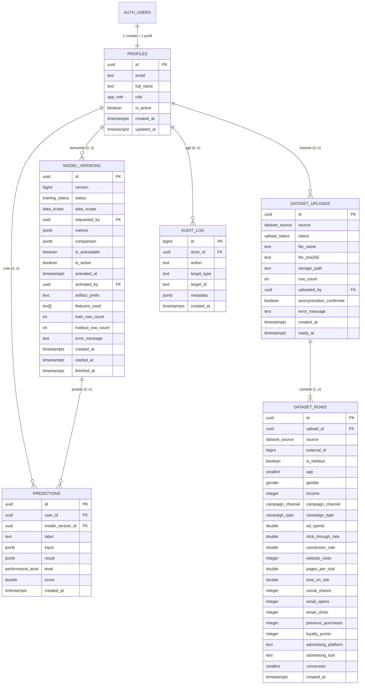

# DATA_MODEL.md : Soro Nua Campaign Predictor

Document de référence n°4 sur 13.
Base : Postgres de la pile Supabase auto-hébergée (conteneur `supabase-db`, image `supabase/postgres`), schéma `public`. Toutes les dates sont en `timestamptz` (UTC).

---

## 1. Schéma entité-relation



## 2. Cardinalités

| Relation | Cardinalité | Règle de suppression |
|---|---|---|
| `auth.users` → `profiles` | 1 à 1 | `on delete cascade` |
| `profiles` → `predictions` | 1 à 0..n | `on delete cascade` |
| `profiles` → `dataset_uploads.uploaded_by` | 1 à 0..n (null pour le jeu de départ) | `on delete set null` |
| `profiles` → `model_versions.requested_by` / `activated_by` | 1 à 0..n | `on delete set null` |
| `profiles` → `audit_log.actor_id` | 1 à 0..n (null pour les actions système) | `on delete set null` |
| `dataset_uploads` → `dataset_rows` | 1 à 1..n | `on delete cascade` |
| `model_versions` → `predictions` | 1 à 0..n | `on delete restrict` (une version utilisée n'est jamais supprimée) |

Les comptes ne sont jamais supprimés par le produit (désactivation uniquement). Les cascades ne servent qu'en cas d'intervention d'exploitation.

## 3. Types énumérés

```sql
create type public.app_role as enum ('marketer', 'admin');
create type public.gender as enum ('Male', 'Female');
create type public.campaign_channel as enum ('Social Media', 'Email', 'PPC', 'SEO', 'Referral');
create type public.campaign_type as enum ('Awareness', 'Consideration', 'Conversion', 'Retention');
create type public.dataset_source as enum ('seed', 'agency');
create type public.upload_status as enum ('importing', 'ready', 'failed');
create type public.training_status as enum ('queued', 'running', 'succeeded', 'failed');
create type public.data_scope as enum ('all', 'agency_only');
create type public.performance_level as enum ('low', 'medium', 'high');
```

Les valeurs de `gender`, `campaign_channel` et `campaign_type` sont exactement celles du jeu de départ (casse et espaces compris). Elles sont reprises à l'identique dans `apps/api/app/domain/dataset_schema.py` ; un test vérifie la concordance.

## 4. Tables

### 4.1 `profiles`

| Champ | Type | Contraintes |
|---|---|---|
| `id` | `uuid` | PK, FK `auth.users(id)` on delete cascade |
| `email` | `text` | not null, unique, copie de `auth.users.email` |
| `full_name` | `text` | not null, `char_length between 1 and 120` |
| `role` | `app_role` | not null, défaut `'marketer'` |
| `is_active` | `boolean` | not null, défaut `true` |
| `created_at` | `timestamptz` | not null, défaut `now()` |
| `updated_at` | `timestamptz` | not null, défaut `now()`, mis à jour par déclencheur |

Index : `profiles_role_active_idx (role, is_active)`.

Déclencheurs :
- `on_auth_user_created` (sur `auth.users`, after insert) appelle `public.handle_new_user()` (security definer) : crée le profil avec `role = 'marketer'`, `full_name = coalesce(raw_user_meta_data->>'full_name', split_part(email, '@', 1))`. Le rôle n'est **jamais** lu depuis les métadonnées utilisateur (modifiables par l'utilisateur lui-même).
- `profiles_guard_last_admin` (before update) : prend d'abord un verrou transactionnel `pg_advisory_xact_lock(hashtext('profiles_admin_guard'))` pour sérialiser les modifications concurrentes, puis refuse toute modification qui laisserait zéro profil `role = 'admin' and is_active` ; lève l'erreur `P0001` avec le message `LAST_ADMIN`.
- `profiles_set_updated_at` (before update).

### 4.2 `dataset_uploads`

| Champ | Type | Contraintes |
|---|---|---|
| `id` | `uuid` | PK, défaut `gen_random_uuid()` |
| `source` | `dataset_source` | not null |
| `status` | `upload_status` | not null, défaut `'importing'` |
| `file_name` | `text` | not null, `char_length between 1 and 255` |
| `file_sha256` | `text` | not null, `~ '^[0-9a-f]{64}$'` |
| `storage_path` | `text` | null pour le jeu de départ |
| `row_count` | `integer` | not null, `> 0` |
| `uploaded_by` | `uuid` | FK `profiles(id)`, null pour le jeu de départ |
| `anonymization_confirmed` | `boolean` | not null ; `check (source = 'seed' or anonymization_confirmed)` |
| `error_message` | `text` | null |
| `created_at` | `timestamptz` | not null, défaut `now()` |
| `ready_at` | `timestamptz` | null ; `check ((status = 'ready') = (ready_at is not null))` |

Index :
- `dataset_uploads_sha_unique` : unique `(file_sha256) where status in ('importing', 'ready')` (un même fichier ne peut pas être importé deux fois).
- `dataset_uploads_seed_unique` : unique `(source) where source = 'seed'` (un seul jeu de départ).
- `dataset_uploads_created_idx (created_at desc)`.

### 4.3 `dataset_rows`

| Champ | Type | Contraintes |
|---|---|---|
| `id` | `uuid` | PK, défaut `gen_random_uuid()` |
| `upload_id` | `uuid` | not null, FK `dataset_uploads(id)` on delete cascade |
| `source` | `dataset_source` | not null (copie de l'import, pour filtrer sans jointure) |
| `external_id` | `bigint` | not null, `>= 1` (colonne `CustomerID` ; numéro de campagne pour l'agence) |
| `is_holdout` | `boolean` | not null (calculé par l'application, voir `LLD.md` section 5.3) |
| `age` | `smallint` | not null, `between 18 and 100` |
| `gender` | `gender` | not null |
| `income` | `integer` | not null, `between 0 and 100000000` |
| `campaign_channel` | `campaign_channel` | not null |
| `campaign_type` | `campaign_type` | not null |
| `ad_spend` | `double precision` | not null, `> 0 and <= 10000000` |
| `click_through_rate` | `double precision` | not null, `between 0 and 1` |
| `conversion_rate` | `double precision` | not null, `between 0 and 1` |
| `website_visits` | `integer` | not null, `between 0 and 100000000` |
| `pages_per_visit` | `double precision` | not null, `between 0 and 1000` |
| `time_on_site` | `double precision` | not null, `between 0 and 1440` |
| `social_shares` | `integer` | not null, `between 0 and 10000000` |
| `email_opens` | `integer` | not null, `between 0 and 10000000` |
| `email_clicks` | `integer` | not null, `between 0 and 10000000` |
| `previous_purchases` | `integer` | not null, `between 0 and 10000` |
| `loyalty_points` | `integer` | not null, `between 0 and 10000000` |
| `advertising_platform` | `text` | not null, `char_length between 1 and 100` |
| `advertising_tool` | `text` | not null, `char_length between 1 and 100` |
| `conversion` | `smallint` | not null, `in (0, 1)` |
| `created_at` | `timestamptz` | not null, défaut `now()` |

Index :
- `dataset_rows_source_external_unique` : unique `(source, external_id)`.
- `dataset_rows_upload_idx (upload_id)`.
- `dataset_rows_scope_idx (source, is_holdout)`.
- `dataset_rows_type_idx (campaign_type)`.

### 4.4 `model_versions`

| Champ | Type | Contraintes |
|---|---|---|
| `id` | `uuid` | PK, défaut `gen_random_uuid()` |
| `version` | `bigint` | `generated always as identity`, unique (numéro affiché "v1", "v2"...) |
| `status` | `training_status` | not null, défaut `'queued'` |
| `data_scope` | `data_scope` | not null |
| `requested_by` | `uuid` | FK `profiles(id)` |
| `data_cutoff_at` | `timestamptz` | not null, défaut `now()` (seuls les imports prêts avant cette date sont utilisés) |
| `metrics` | `jsonb` | null ; structure en section 4.7 |
| `comparison` | `jsonb` | null ; structure en section 4.7 |
| `global_importance` | `jsonb` | null ; structure en section 4.7 |
| `is_activatable` | `boolean` | not null, défaut `false` |
| `is_active` | `boolean` | not null, défaut `false` ; `check (not is_active or status = 'succeeded')` |
| `activated_at` | `timestamptz` | null |
| `activated_by` | `uuid` | FK `profiles(id)` |
| `artifact_prefix` | `text` | null, forme `versions/<id>/` |
| `features_used` | `text[]` | null |
| `train_row_count` | `integer` | null |
| `holdout_row_count` | `integer` | null |
| `error_message` | `text` | null, message lisible par l'administrateur |
| `created_at` | `timestamptz` | not null, défaut `now()` |
| `started_at` | `timestamptz` | null |
| `finished_at` | `timestamptz` | null |

Index :
- `model_versions_one_active` : unique `((true)) where is_active` (une seule version active).
- `model_versions_one_in_progress` : unique `((true)) where status in ('queued', 'running')` (un seul apprentissage à la fois).
- `model_versions_created_idx (created_at desc)`.

### 4.5 `predictions`

| Champ | Type | Contraintes |
|---|---|---|
| `id` | `uuid` | PK, défaut `gen_random_uuid()` |
| `user_id` | `uuid` | not null, défaut `auth.uid()`, FK `profiles(id)` on delete cascade |
| `model_version_id` | `uuid` | not null, FK `model_versions(id)` on delete restrict |
| `label` | `text` | null, `char_length <= 120` |
| `input` | `jsonb` | not null, `jsonb_typeof(input) = 'object'` (objet `CampaignInput` validé, voir `API_SPEC.md`) |
| `result` | `jsonb` | not null, `jsonb_typeof(result) = 'object'` (objet `PredictionResult` complet) |
| `level` | `performance_level` | not null (copie pour la liste) |
| `score` | `double precision` | not null, `between 0 and 100` |
| `created_at` | `timestamptz` | not null, défaut `now()` |

Index : `predictions_user_created_idx (user_id, created_at desc, id desc)` (liste paginée).

Pas de mise à jour : une prédiction enregistrée est figée.

### 4.6 `audit_log`

| Champ | Type | Contraintes |
|---|---|---|
| `id` | `bigint` | `generated always as identity`, PK |
| `actor_id` | `uuid` | FK `profiles(id)`, null pour une action système |
| `action` | `text` | not null, parmi la liste ci-dessous |
| `target_type` | `text` | not null, parmi `user`, `upload`, `model_version` |
| `target_id` | `text` | not null |
| `metadata` | `jsonb` | not null, défaut `'{}'` ; jamais de secret ni de mot de passe |
| `created_at` | `timestamptz` | not null, défaut `now()` |

Actions autorisées (contrainte `check`) : `user.invited`, `user.role_changed`, `user.deactivated`, `user.reactivated`, `upload.accepted`, `upload.failed`, `model.training_requested`, `model.training_succeeded`, `model.training_failed`, `model.activated`.

Index : `audit_log_created_idx (created_at desc, id desc)`.

Table en ajout seul : aucun droit `update` ni `delete` pour personne, sauf `postgres`.

### 4.7 Structures JSON

`model_versions.metrics` :
```json
{
  "click_through_rate": {"mae": 0.0712, "rmse": 0.0823, "r2": -0.03, "baseline_mae": 0.0710, "reliability": "low"},
  "conversion_rate":    {"mae": 0.0475, "rmse": 0.0551, "r2": -0.04, "baseline_mae": 0.0473, "reliability": "low"},
  "website_visits":     {"mae": 12.61,  "rmse": 14.58,  "r2": -0.05, "baseline_mae": 12.55,  "reliability": "low"},
  "overall_reliability": "low"
}
```
Règle `reliability` : `r2 < 0.10` donne `low`, `0.10 <= r2 < 0.40` donne `moderate`, `r2 >= 0.40` donne `good`. `overall_reliability` suit la moyenne des trois `r2`.

`model_versions.comparison` (null si aucune version active au moment de l'évaluation) :
```json
{
  "against_version_id": "uuid",
  "against_version": 3,
  "per_target": {
    "click_through_rate": {"previous_mae": 0.0712, "new_mae": 0.0705, "change_pct": -0.98},
    "conversion_rate":    {"previous_mae": 0.0475, "new_mae": 0.0476, "change_pct": 0.21},
    "website_visits":     {"previous_mae": 12.61,  "new_mae": 12.50,  "change_pct": -0.87}
  },
  "mean_mae_ratio": 0.9945,
  "verdict": "at_least_as_reliable"
}
```
`verdict` vaut `at_least_as_reliable` si `mean_mae_ratio <= 1.0`, sinon `less_reliable`.

`model_versions.global_importance` :
```json
{
  "click_through_rate": [{"field": "ad_spend", "share": 0.14}, {"field": "campaign_type", "share": 0.11}],
  "conversion_rate": [],
  "website_visits": []
}
```
Les parts de chaque chiffre somment à 1 et sont triées par ordre décroissant.

## 5. Fonctions de base de données

```sql
create or replace function public.is_active_user() returns boolean
language sql stable security definer set search_path = '' as $$
  select exists (
    select 1 from public.profiles p
    where p.id = (select auth.uid()) and p.is_active
  );
$$;

create or replace function public.is_admin() returns boolean
language sql stable security definer set search_path = '' as $$
  select exists (
    select 1 from public.profiles p
    where p.id = (select auth.uid()) and p.role = 'admin' and p.is_active
  );
$$;
```

`public.activate_model_version(p_version_id uuid, p_expected_active_id uuid) returns public.model_versions`, `security definer`, `set search_path = ''` :
1. Si `not public.is_admin()` : erreur `FORBIDDEN`.
2. Verrouille la version active courante (`for update`) et la version cible.
3. Si l'identifiant de la version active courante (ou null) diffère de `p_expected_active_id` : erreur `ACTIVE_VERSION_CHANGED`.
4. Si la cible n'est pas `succeeded` ou pas `is_activatable` : erreur `MODEL_NOT_ACTIVATABLE`.
5. Met `is_active = false` sur l'ancienne, `is_active = true, activated_at = now(), activated_by = auth.uid()` sur la cible.
6. Insère `model.activated` dans `audit_log`.
7. Retourne la ligne cible.

`public.log_audit(p_action text, p_target_type text, p_target_id text, p_metadata jsonb) returns void`, `security definer` : réservée aux administrateurs actifs, renseigne `actor_id = auth.uid()`.

Les erreurs levées par ces fonctions utilisent `raise exception '<CODE>' using errcode = 'P0001'`. L'API traduit `<CODE>` en code d'erreur standard (voir `API_SPEC.md`).

## 6. Règles d'isolation des données (RLS)

RLS est **activée et forcée** (`alter table ... enable row level security; alter table ... force row level security;`) sur toutes les tables de `public`. Aucun droit pour le rôle `anon` sur aucune table (`revoke all on all tables in schema public from anon;`).

| Table | Lecture | Création | Modification | Suppression |
|---|---|---|---|---|
| `profiles` | sa propre ligne (`id = auth.uid()`), ou toutes si `is_admin()` | aucune (déclencheur uniquement) | `is_admin()` et `id <> auth.uid()`, colonnes `full_name`, `role`, `is_active` seulement (droits par colonne) | aucune |
| `dataset_uploads` | `is_admin()` | `is_admin()` et `uploaded_by = auth.uid()` et `source = 'agency'` | `is_admin()` (passage de statut) | `is_admin()` et `status in ('importing', 'failed')` |
| `dataset_rows` | `is_admin()` | `is_admin()` et `source = 'agency'` | aucune | via cascade uniquement |
| `model_versions` | `is_active_user()` | `is_admin()` et `requested_by = auth.uid()` et `status = 'queued'` | aucune (worker en clé de service ; activation par `activate_model_version`) | aucune |
| `predictions` | `user_id = auth.uid()` et `is_active_user()` | `user_id = auth.uid()` et `is_active_user()` | aucune | `user_id = auth.uid()` et `is_active_user()` |
| `audit_log` | `is_admin()` | via `log_audit()` ou clé de service | aucune | aucune |

Points explicites :
- **Un administrateur ne voit pas l'historique de prédictions des autres utilisateurs.** Aucune politique ne l'y autorise (moindre privilège).
- Un utilisateur désactivé (`is_active = false`) ne lit plus rien, même avec un jeton encore valide.
- Toutes les politiques utilisent `(select auth.uid())` pour éviter une réévaluation par ligne.

Exemple complet pour `predictions` :
```sql
alter table public.predictions enable row level security;
alter table public.predictions force row level security;

create policy predictions_select_own on public.predictions
  for select to authenticated
  using (user_id = (select auth.uid()) and public.is_active_user());

create policy predictions_insert_own on public.predictions
  for insert to authenticated
  with check (user_id = (select auth.uid()) and public.is_active_user());

create policy predictions_delete_own on public.predictions
  for delete to authenticated
  using (user_id = (select auth.uid()) and public.is_active_user());
```

### Stockage (Supabase Storage, conteneur `supabase-storage`, fichiers sur volume disque)

| Espace | Public | Lecture | Écriture | Suppression |
|---|---|---|---|---|
| `dataset-uploads` | non | `is_admin()` | `is_admin()`, chemin `<upload_id>/<nom>` | aucune |
| `model-artifacts` | non | clé de service uniquement | clé de service uniquement | aucune |

Politiques posées sur `storage.objects` avec `bucket_id` et `public.is_admin()`. Taille maximale de fichier du bucket `dataset-uploads` : 10 Mo ; type MIME autorisé : `text/csv`.

## 7. Migrations et versionnement

- Outil : Supabase CLI, exécutée dans le conteneur `toolbox` et toujours pointée sur une base explicite (`--db-url`). Fichiers dans `supabase/migrations/`, nommés `YYYYMMDDHHMMSS_<description_en_snake_case>.sql`, créés par `supabase migration new <description>`.
- **Une migration appliquée n'est jamais modifiée.** Toute correction passe par une nouvelle migration.
- Migrations en avant uniquement. Chaque migration doit rester compatible avec la version précédente de l'application (principe "étendre puis réduire") :
  - ajout d'une colonne : nullable ou avec défaut ;
  - suppression ou renommage : en deux livraisons, d'abord le code cesse d'utiliser la colonne, ensuite la migration la retire.
- Les schémas internes de la pile (`auth`, `storage`, `extensions`) sont créés par les images officielles au premier démarrage ; nos migrations ne les modifient jamais, sauf les politiques sur `storage.objects` et la création des espaces dans `storage.buckets`.
- Chaque migration qui crée une table crée dans le même fichier : activation et forçage de RLS, politiques, index, droits.
- Tests de base (pgTAP) dans `supabase/tests/database/*.test.sql`, exécutés par `supabase test db --db-url <base locale>` contre le conteneur `supabase-db`. Chaque politique RLS a au moins un test positif et un test négatif.
- Application :
  - local : `make db-reset` (recrée le volume de `supabase-db`, puis `supabase migration up --db-url`) ;
  - staging et production : `supabase db push --db-url $DATABASE_URL_<ENV>` exécuté par le pipeline depuis CodeBuild dans le VPC (voir `CI_CD.md`), jamais à la main.
- L'historique des migrations appliquées est tenu par la Supabase CLI dans la table `supabase_migrations.schema_migrations`. L'API expose la dernière version appliquée dans `/api/ready`.
- Ordre initial des migrations :
  1. `..._init_enums_profiles.sql` : types, `profiles`, `is_admin()`, `is_active_user()`, déclencheurs, RLS ;
  2. `..._audit_log.sql` : `audit_log`, `log_audit()` ;
  3. `..._datasets.sql` : `dataset_uploads`, `dataset_rows`, bucket `dataset-uploads` et ses politiques ;
  4. `..._model_versions.sql` : `model_versions`, bucket `model-artifacts`, `activate_model_version()` ;
  5. `..._predictions.sql` : `predictions`.
